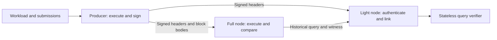

# Continuous full-node and light-node demo

Status: implemented bounded demo profile, 2026-09-24. The producer, full
and light processes, protocol-2 execution and complete equality-proof API
are present. [Run and test the demo](full-light-demo-run.md); see the
[literal proof charge vectors](eq-proof-charges.md). This contract records
the implementation's scope, trust assumptions and acceptance requirements.

## Goal and scope

Run a producer, an independently executing full node and a light node as
separate processes. The producer continuously appends blocks. Both clients
follow the same chain, including when joining late or reconnecting. A user
can query a selected historical block and see the full node's locally
executed answer alongside the light node's verified answer, while newer
blocks continue arriving.

The user-requested distinction is full versus light clients. **There is no
pruning in this demo.** The producer and full node retain every block,
outcome, snapshot and reachable proof object for their process lifetime.
The light node retains all accepted headers but never acquires the database
or executes blocks. Separating a pruned full node from an archive node,
retention windows, GC, compaction and archival routing are later work.

The development authentication is one configured producer signing
headers with a pinned Ed25519 key. This is a design choice for a runnable
demo, not a user-mandated consensus protocol. The choice isolates query
verification from future host consensus integration. Multiple producers,
fork choice, reorgs, public-chain consensus, transaction signatures and SDK
wire compatibility are outside this deliverable.

The first run remains volatile. A process restart loses its local history;
a client can rebuild from a still-running peer. Every producer process
restart creates a new genesis identity. Same-chain producer recovery needs
a separate last-signed-height and exclusive-signer contract and is deferred.
Follower replay is not durable engine recovery or completion of N3c/N4.

## Existing code and required additions

| Foundation today | Demo addition |
| --- | --- |
| `arkiv-node/src/replay.rs`: `MemoryChain::produce`, `apply`, historical snapshots and request identities | Process roles, a bounded queue, complete block/body retention, transport and catch-up. `apply` already compares re-executed outcomes and header bytes before publication. |
| `arkiv-node/src/block.rs`: v1/v2 header encoding and hashes | Activate protocol 2 through genesis validation, successor validation and execution. Protocol 2 now activates the existing v2 serialization; legacy protocol 1 remains replayable. |
| `arkiv-node/src/exec.rs`: one executor, admin/expiry/user sequencing, sealed terminal candidate | Put that candidate's state root in each produced v2 header, and compare it on full-node application before publication. |
| `arkiv-db/src/state.rs` and `layout.rs`: state format 1, catalog roots, namespace map roots and canonical leaves | Bounded engine proof generation and stateless decoding/verification of the needed catalog, term, row and key-binding evidence. These layout types are mostly private today. |
| `arkiv-db-trie`: point proofs and strict `walk` verifier | Compose those proofs up to a trusted state root; reconstruct a complete equality posting set to prove page completeness. Map-level point proofs alone are insufficient. |

Keep execution/query semantics in `arkiv-db`, chain execution in
`arkiv-node`, and process/RPC orchestration at the host boundary. Expose a
stateless verification API which cannot access an `Engine`, loader, RPC or
mutable head. Sharing the strict codec and trie verifier is acceptable;
tests must independently derive expected results and posting roots. Do not
expose mutable internal maps merely to make the proof server work.

## Roles and trust boundaries



- **Producer:** owns the signing key, runs the existing deterministic
  executor, seals one candidate, makes the block/body/snapshot mapping
  visible atomically, then announces the signed header. Manual and interval
  triggers share one writer path. The workload can submit transactions;
  queue acceptance means pending in memory, not inclusion or durability.
- **Full node:** owns a separate `MemoryChain`. Checks header authentication,
  linkage, input/outcome digests and block admission, re-executes inputs,
  and compares outcomes and terminal root before publishing its local
  head. Retains complete history and serves historical proofs. It must
  not trust producer outcomes as its execution result or copy the producer's
  engine snapshot. A serving full node can also relay retained signed
  headers and bodies to another follower.
- **Light node:** owns a header chain and a bounded result cache, with no
  block executor, state database or signing key. Checks the configured
  signer and continuity; queries the full node, then derives results from
  proofs against its own accepted header. The serving endpoint and every
  response field are untrusted inputs. The light node can also query the
  producer without changing verification rules.

`MemoryChain` retains headers/snapshot ids. The demo host adds a complete
volatile block log and uses `prepare`/`finalize` for its publication boundary: prepare the body and signature and complete all
fallible preparation before making the combined signed-header/body/snapshot
catalog entry visible. Refactor prepare/finalize as needed. RPC reads and
announcements use only that published catalog; an execution return alone
must not announce a block whose body or signature is still unavailable.

The operator supplies the trust configuration out of band: exact genesis
bytes, expected genesis block hash and producer public key. Never learn the
trusted key or genesis from the query endpoint. RPC URLs are locators, not
trust anchors. Default listeners bind to loopback; local actor identity
remains the existing explicitly trusted development actor context.

A signature proves that the configured key endorsed the header. It does
**not** prove valid execution, correct indexes, data availability, freshness
or public consensus/finality. The light client trusts this producer to sign
valid, append-only states. A full node independently checks execution, but
its success is not an execution proof delivered to the light node. The UI
must distinguish `execution checked`, `producer authenticated` and
`query proof verified`; never call the latter two `consensus verified`.

Equality completeness below is relative to the authenticated index and the
execution invariant that this index exactly represents live rows. A
malicious signer can sign a state whose index omits a matching row; the
light client alone cannot detect that omission with this witness. The full
node rejects such a root when replaying the recorded inputs. Replacing this
trust assumption requires consensus/validity evidence or a broader state
proof, not another signature on the same root.

Two valid signed headers at one height, or a signed successor with a
different accepted parent, are observed equivocation. Stop advancing,
retain both headers as evidence and surface a conflict. Never choose the
longer branch automatically. An isolated client cannot detect an unseen
alternative history, and replaying a valid old prefix does not prove that
prefix is current. A timeout means `stalled`, not proof of a malicious peer.

## Versioned commitments and wire contract

Use existing canonical codec version 1, state format 1, record-key encoding
v2 and block-format-1 inputs/outcomes unchanged. JSON is transport only:
hashes and bytes are lowercase, even-length hex with `0x`; all 64-bit
integers, including signed I64 values, are decimal strings, so a browser
cannot round heights, ids or values. Reject unknown
fields/tags/versions and malformed or oversized payloads before allocation.
Hashed/signed objects use canonical binary bytes, never JSON text.

### Protocol 2 activation

Protocol-2 genesis uses the existing genesis layout with `protocol_version
= 2`. Its height-zero header is v2 and contains the root of the initial
engine (genesis pricing, empty catalog and host map). Its inputs digest is
the existing genesis digest, outcomes are empty, and parent hash is zero.
Compute the genesis root before hashing the header; do not put the genesis
block hash or any block's own hash in engine state.

For every later height B, seal after admin inputs, expiry and transactions;
set `header.state_root = Some(candidate.state_root())`. This is the state
**after B**. `MemoryChain::apply` must compare this root before publishing,
including on empty blocks. A root-bearing header without a correctly
activated protocol-2 genesis is invalid. Use a new development genesis;
do not rewrite an old protocol-1 chain. Preserve v1 codec fixtures and any
explicit legacy replay support, but never accept v1 headers in this demo.

### Authentication envelope

All integers below use codec big-endian widths, and hashes are 32 raw bytes.
These layouts are frozen with hand-built D0 vectors:

```text
TrustConfigV1 = u32(1) | bytes(canonical Genesis) | genesis_hash | key[32]
SignedHeaderV1 = u32(1) | genesis_hash | HeaderV2 | signature[64]
signing_message = digest("arkiv/demo-sign/v1",
                         u32(1) | genesis_hash | HeaderV2.hash())
signature = Ed25519.sign(signing_message)
```

Use one maintained signature implementation with strict verification and
fixed-size key/signature parsing. No signing-key rotation in v1. The
signature stays outside the existing header hash. The genesis hash binds
the execution limits and pricing; the pinned key binds the authority.
Clients require both. Sign the genesis header as well, under its own
already-computed hash. Store each signature with its retained header so
relays do not re-sign. The secret key is a producer-only local file and is
never returned by RPC, logged, or shipped to other roles.

### RPC v1

Use bounded HTTP request/response polling for the first demo. It supports
real separate processes without adding streaming backpressure, gossip or
peer discovery. Every response carries `rpcVersion: 1`; expose capabilities
with exact protocol, authentication and proof-profile versions.

| Method | Contract |
| --- | --- |
| `status` | Role, genesis hash, accepted head number/hash, sync/health state, actual retained coverage and supported proof profiles. A peer's claimed head/coverage is advisory. |
| `headers(afterHeight, afterHash, limit)` | Contiguous signed headers after the exact supplied anchor; bounded batch and sampled head. A mismatched anchor is an error, never an alternative fork. Genesis is fetched separately and compared with trust configuration. |
| `blocks(fromHeight, limit)` | Contiguous canonical blocks and their signed headers from retained history. Full-node callers verify every body digest and execute in order. |
| `submit(envelope)` / `requestStatus(identity)` | Producer only; reuse current request conflict/deduplication semantics. Status says pending, included at B, or unknown in this volatile run. |
| `produceBlock` | Producer only; deterministic test/manual trigger on the same writer path as the timer. |
| `queryEq(request, proof: "eq-page-v1")` | Producer or caught-up full node; resolve and pin one exact block, return bounded equality evidence described below. |

Unproved general queries may remain available through the existing N1 read
surface, explicitly labelled unverified. The light-client verified path
never falls back to them. A server may enforce stricter operational limits
than advertised, but cannot truncate a successful page or downgrade proof
mode. Error responses are availability/admission information, not proven
negative answers.

### Bootstrap, catch-up and restart

1. Load and validate the local trust configuration and genesis. The full
   node constructs its own genesis engine; the light node validates the
   pinned genesis header and initial state commitment without loading rows.
2. Poll from the last locally accepted `(height, hash)`. Validate the
   authentication envelope, genesis identity, protocol/header version,
   chain id, exact next height, parent hash and nondecreasing timestamp.
   Reject counter overflow. Apply each valid prefix atomically per block;
   a later bad entry must not roll back that prefix or advance past it.
3. The full node fetches and applies matching bodies before moving its
   **executed** head. It may have a higher authenticated-header target, but
   never serves queries from unexecuted heights. The light node advances
   after header validation and requests proofs only at accepted heights.
4. Catch up in bounded batches while production continues, then poll at a
   configured interval. Disconnects preserve the local accepted anchor;
   reconnect resumes there. Duplicate identical data is idempotent. Gaps
   are refetched; inconsistent or conflicting data stops advancement.
5. A restarting volatile follower starts from genesis and resynchronizes.
   It may instead use a local recorded-header checkpoint only under an
   explicitly separate future persistence contract; the demo makes no
   restart-survival claim for headers or cursors.

There is no checkpoint/snapshot state download in v1: the full node
replays from genesis and the light node downloads the header sequence.
When a peer lacks history, report `HistoryUnavailable`; retain the chosen
block and try another configured peer if available. Never substitute head.
Every producer restart starts a **new run with a new genesis identity**;
the launcher supplies new trust configuration to clients explicitly. A
valid recorded chain may be a truncated prefix of previously signed work,
so replay alone does not authorize resuming the old signer/genesis. Same-chain
producer recovery is outside v1. Enforce one producer per run; the launcher
must not accidentally start concurrent instances with the same identity.

## Complete equality page proof: `eq-page-v1`

The supported expression is exactly one positive `Eq(attribute, value)`
with any indexable type (every scalar except `Bytes`; the JSON forms are in
`crates/arkiv-node/src/value_json.rs`), using current typed equality and
indexed-value bounds. Order is ascending `RecordId`. Projection is fixed
to id, key and **all cells**. No AND/OR, negation, ranges, prefixes,
`Exists`, sorting, `Bytes` equality, count endpoint or selectable projection
is claimed by this profile. Reject them with `UnsupportedProof`.

This small profile avoids a new range-proof algorithm. Each response
includes the **entire equality posting set**, even for a small page. Its
cost is O(posting size + page row witnesses); do not describe it as
constant-size or page-only work. The posting-set cap below is an explicit
demo limitation. Larger sets fail as `ProofLimitExceeded`.

### Query, snapshot and continuation identity

```text
EqQueryV1 = u32(1) | NamespaceId | CellName | Value | u8(1) | u8(1)
           // final tags: ascending RecordId, full-row projection
query_digest = digest("arkiv/eq-query/v1", encode(EqQueryV1))
SnapshotRefV1 = u32(1) | genesis_hash | height:u64 | block_hash | state_root
CursorV1 = u32(1) | SnapshotRefV1 | query_digest | last_id:u64
Request = { snapshot: SnapshotRefV1, query: EqQueryV1,
            limit: u32, continuation: optional CursorV1 }
```

The light client resolves a user-selected `latest` once to its own accepted
header, then sends an exact `SnapshotRefV1`. An explicit height unavailable
locally first requires header synchronization. The server checks the
height/hash/root together. The request's query and snapshot, not copies
suggested by the server, are verifier inputs. Page size may change on
continuation and is not part of the query digest.

The initial request has no cursor. The verifier derives the next cursor
from the last row of a verified nonterminal page; the client retains that
verified continuation. A server token cannot establish a starting boundary.
For a complete walk the client accepts continuation only from its prior
verified page, with unchanged snapshot/query and identical last id. A
restart discards that context and begins again at page one. Wire cursors
use stable block identity, never the engine's process-local `SnapshotId`
or opaque `Cursor`. The server adapter may translate or implement the
positioned read internally; do not weaken existing engine cursor checks.

### Witness and verification algorithm

Proof encoding v1 is a strict tagged binary object using codec sequence
and byte-string rules. `ProofPath` is `Vec<bytes>` in trie path order.
`RowWitness` is `id:u64 | row:ProofPath | key_binding:ProofPath`.
The response contains one of these tags, never a mixture:

```text
NamespaceAbsent(1) = StateHeader | catalog:ProofPath
EqPage(2) = StateHeader | catalog:ProofPath | term:ProofPath
            | posting_ids:Vec<u64> | page_rows:Vec<RowWitness>
            | next:Option<CursorV1>
ProofResponseV1 = u32(1) | SnapshotRefV1 | query_digest | tagged evidence
```

No separate unverified data array is needed: the verifier returns decoded
rows and `VerifiedContinuation` after all checks pass. If a JSON display
copy is included, compare it exactly with those derived rows before display.
The signature/header evidence comes from the light client's header store,
not from an arbitrary `state_root` in this response.

Verification proceeds as follows, under the caller's resource limits:

1. Require exact request snapshot/query identity and a locally accepted v2
   header whose root equals the requested root. Strictly decode the
   `StateHeader`; recompute `digest("arkiv/state/v1", encode(header))` and
   compare with that root. Do not accept a different pricing, catalog or
   host commitment supplied by the server.
2. Encode the requested namespace id as the state format's 8-byte key and
   call strict `walk` against `catalog_root`. Decode the returned namespace
   leaf canonically and check its descriptor id equals the request. A
   proven absence returns `VerifiedNamespaceAbsent`, surfaced as
   `NamespaceNotFound`, **not** a successful empty query. A missing or
   truncated path is a verification error, not absence.
3. Derive the exact 88-byte value-term key from the caller's attribute and
   typed value using `layout.rs` rules (presence byte 1); prove it against
   the authenticated namespace term root. A proven absent term requires
   empty ids, empty rows and no next cursor: it proves an empty Eq result
   in this existing namespace. A present leaf is the canonical posting
   root plus nonzero u64 count.
4. Require nonzero, strictly increasing, unique `posting_ids`, with exactly
   the authenticated posting count. Reconstruct a canonical trie from
   **all** these ids: key = 8-byte big-endian id, value = byte `01`
   (`Member`), using the existing trie encoding. Require the reconstructed
   root to equal the authenticated posting root. Count alone, or unrelated
   membership proofs for whichever rows the server returns, is insufficient.
   Removing, duplicating, inserting or replacing an id changes the checked
   set. No scan of another namespace is involved.
5. For page one take the first `limit` ids; for a continuation validated
   against the previous page, take the first `limit` ids strictly greater
   than its last id. Require the cursor id itself to belong to the complete
   authenticated `posting_ids`, and require the prior verified page to have
   been nonterminal. The selected page ids are exactly the ids `page_rows`
   must contain, once each in order.
   Determine whether more ids remain from the complete reconstructed set;
   check `next` is present exactly then and equals the locally derived
   cursor. No server-supplied offset or claimed terminal page is trusted.
6. For each expected id, verify the row path under the authenticated row
   root using the derived 8-byte key. Strictly decode the whole stored row,
   enforce row/cell limits, and verify that its requested cell is an
   attribute of exactly the requested type and value. A field, missing cell
   or differently typed value cannot satisfy equality. Derive the row's
   33-byte record-key-v2 encoding and verify its binding under the namespace
   key-map root equals this id. Return the id, key and all decoded cells.
7. Reject leftover paths, nodes, rows and bytes, inconsistent option tags
   and any mismatch. Construct `VerifiedPage` only after the entire page
   succeeds; never expose partially verified rows.

All evidence describes the selected block. Expiry is already reflected in
its row/index roots; the verifier must not consult wall-clock time or head
to filter historical rows. Full row leaves disclose unselected fields too;
the fixed full-row projection makes that cost and disclosure explicit.

## Resource bounds and errors

The v1 demo defaults below are local policy, not newly asserted consensus
limits. Genesis still supplies block admission and execution limits. Reject
oversized HTTP bodies before decoding; enforce semantic caps and checked
arithmetic before loops, vector reservation or root reconstruction.

| Resource | Default cap |
| --- | --- |
| Header batch | 128 |
| Block batch | 16, further bounded by response bytes |
| Request / response body | 1 MiB / 8 MiB, including hex/JSON transport expansion |
| Pending queue | 1,024 transactions and 8 MiB encoded bytes |
| Equality posting ids / page rows | 4,096 / min(64, genesis `max_page`); page limit must be at least 1 |
| Proof response bytes / supplied trie nodes | 8 MiB / 8,192; also enforce each path's structural bound |
| In-flight proof requests per server / client | 4 / 2 |
| Request deadline | 5 seconds; reconnect backoff bounded at 5 seconds |

Every published signed block must fit one `blocks` response at the
advertised cap, including outcomes and transport expansion. Validate
compatible genesis limits at startup, bound selection, and check the exact
encoded signed-block response size before signing/publication. If it does
not fit, discard the candidate and report the production error; never
publish an unservable height. Batch responses include only whole blocks
and at least one when the requested next block exists. Tests cover the
largest admitted block and an over-cap candidate leaving head unchanged.

The structural path bounds are catalog 17, term 177, row 17 and key
binding 67 visited nodes; inline nodes count toward traversal work, while
wire nodes are only the root and hash-referenced descendants. Bound row
decoding by the selected genesis's cell/value limits (at most 64 cells).
Count actual received bytes even for chunked HTTP; cap decoded hex bytes
and declared sequence counts against the remaining payload before reserving
vectors. An advertised count over the posting cap fails before constructing
the posting trie. Verifiers
also cap hash/decode work and allocated bytes; raw byte limits alone are
not an allocation strategy. Repeated reads must not grow retained result
cache memory without bound.

Charge serving-side query and proof work through bounded read meters,
using the selected snapshot's pricing. Publish literal charge vectors
before implementing the API: normal index/row work retains existing
counts; `ProofNode` and `ProofByte` cover witness production, including
complete posting evidence. Reserve conservative work/byte capacity before
materializing the next trie node or full row, then account for actual
emitted bytes without performing unbudgeted work. Proof generation needs
its own full-posting iteration charges; do not price it as the ordinary
lazy Eq page. A separate caller-side verification work budget covers root
reconstruction, hashes and row decoding. Read receipts are advisory service
accounting, not consensus receipts or claims established by the query proof.
If new counting classes/rules are needed, version them explicitly; do not
change model-3 write receipt vectors as a side effect.

Distinguish `UnsupportedVersion`, `UnsupportedProof`, `InvalidRequest`,
`CursorMismatch`, `BlockNotSynced`, `UnknownBlock`, `HistoryUnavailable`,
`ProofLimitExceeded`, `BudgetExceeded`, `ServerBusy`, `StorageUnavailable`
and client-side `InvalidHeader`, `ChainConflict`, `InvalidProof`.
Only a verified absent term is an empty Eq result; a catalog absence has
its own verified namespace outcome. `latest` cannot silently change on a
retry. Transport cancellation or budget exhaustion discards partial output.

Retaining every snapshot means memory usage grows with chain history. The
launcher reports it and uses an explicit configured run capacity. Reaching
capacity stops production before another publication, leaving retained
history readable; it never deletes old data. The full follower similarly
stops applying before exceeding its capacity and reports the problem.
Long-running, bounded-RAM operation belongs to the later durable engine.

## Demonstration and acceptance

Provide one launcher and a terminal status view before adding a browser UI.
Defaults: one-second production intervals, a fixed reproducible workload
seed, two namespaces and separate process/RPC addresses. Show producer head,
full executed head, light authenticated head, lag, truncated root/hash,
retained coverage and verification result. Show proof bytes, posting count
and verification time separately from response latency. Use `retained in
memory` and `single-producer development chain` visibly. Values are shown
only from a successful verification result on the light path.
Lag is relative to an observed producer/peer head, not a claim that the
global latest height is known when every contacted peer withholds updates.

The workload continuously creates, patches and deletes records, changes
Eq membership, recreates keys with new record ids, transfers a namespace,
and schedules expiry. Include empty blocks and a deliberately rolled-back
multi-operation transaction. A historical block selector must demonstrate
a row before deletion/expiry, its absence afterwards, and unchanged earlier
pages while production continues. Interactive actions pause/resume either
follower, start a late client and query both clients at one fixed block.
A test proxy supplies deterministic response mutations; failure injection
does not require changing production proof verification.

| Scenario | Required evidence |
| --- | --- |
| Continuous normal run | At least 200 deterministic blocks, two independent full followers and two light followers in integration tests; all caught-up heads agree, full roots/outcomes match the independent model, and verified Eq pages equal its results at sampled historical heights. The default visible demo needs only one of each. |
| Empty and historical results | Existing namespace with absent term, never-created namespace, genesis, empty blocks, patch/type changes, rollback, deletion, key recreation and both sides of expiry produce distinct correct outcomes. |
| Pagination under new writes | Page sizes 1, 3 and 64 concatenate to the oracle's exact ids at pinned B; new blocks and endpoint switching cannot alter B. Skipped first pages, invented cursors, changed query/namespace/block/root and false `next`/terminal claims fail. |
| Header/body attacks | Wrong key, bad signature, another genesis/chain, v1 downgrade, missing height, wrong parent, decreasing timestamp, overflow, body digest tampering and a re-signed false root are rejected at the relevant boundary. The last case is detected by full execution; authentication alone may accept it, which the test labels explicitly. |
| Proof attacks | Keep the accepted header/root fixed; alter state header, descriptor, term key/count/root, row value/type/kind/key/id, posting ids, ordering, duplicate or omitted row, or proof nodes. Test valid membership paths with an incomplete posting list. Every forged answer fails; absent-term/namespace witnesses cannot be forged by truncation. |
| Synchronization | Start late; pause for at least 20 blocks; reconnect and catch up while production continues; duplicate batches, dropped responses and interrupted body fetches never skip or double-apply a block. An unavailable body cannot advance full executed head. |
| Conflicts and stale peers | Observed signed equivocation stops the client; stale valid prefixes show lag/stalled status without being described as current/final. No claim that an unseen fork can be detected. |
| Resource failures | One-above-cap inputs, huge claimed counts, malformed RLP, deeply nested/truncated payloads, proof budget exhaustion and unavailable objects return explicit errors without panic, partial verified output or unbounded allocation. Grow unrelated namespace B and require A's witness work to remain local plus the documented directory path. |
| Retention/restart | Old proofs still verify after later changes; capacity halts without eviction. Restart a follower and rebuild from genesis. Every producer restart requires new genesis identity; a truncated valid recording cannot enable same-chain signing. No durable recovery claim. |

## Implementation order and review gates

This changes the previous `N1 -> N3c/N3d -> N4 -> N5` sequence only for the
bounded demo. N2, N3a and N3b are already done. Implement these reviewable
steps, each with its relevant acceptance tests:

| Step | Deliverable and exit gate |
| --- | --- |
| D0: freeze demo formats and activation | Protocol-2 genesis/root timing; signed header, trust configuration, query/proof/cursor/error codecs and resource/charge rules with literal golden vectors. Existing v1 vectors stay unchanged. No runtime yet. |
| D1: producer and full follower | N1 process/queue/manual and interval production, retained bodies and snapshots, bounded RPC/polling and independent full execution with v2 root checks. Late join, reconnect and false-root tests pass. |
| D2: proof core | The in-memory N3d subset needed here (catalog/term/row/key proofs), complete Eq posting reconstruction and stateless verifier. Oracle, missing-result, absence, historical, cursor and resource tests pass without an RPC server. Other N3d point-read APIs remain pending if not delivered. |
| D3: light follower and integrated demo | Header-only follow, bounded query/proof RPC, verifier-owned continuations, status view/workload and multi-process adversarial scenarios. Light query verification succeeds with no engine instance or block body access. |
| Later: durable node | Resume N3c/N4 with the same logical roots and proof bytes. Engine state and historical proofs must survive restart without full-chain replay; use the existing redb gates. |
| Later: broader proofs and archives | N5 adds other operators, more efficient coverage and SDK integration; N6 later decides pruned-full versus archive behavior, retention and capacity calibration. No pruning is pulled into D0–D3. |

Completing D3 establishes this profile's complete equality queries under
the stated trust model. It does not complete all of N3d, N5, milestone 4,
durability or public consensus integration. The current
[single-block contract](single-block-query-proofs.md),
[namespace contract](project-namespaces.md) and storage acceptance gates
remain in force.

Implementation choices: `ed25519-dalek` 2.2.0 with strict verification,
axum/tokio HTTP with streamed byte caps and deadlines, and reqwest bounded
polling. JSON carries canonical binary objects as lowercase hex; read
receipt model 4 is scoped to proof generation, with model-3 writes intact.
The terminal launcher is the delivered UI. The library has no durable
signer-resume path, and the CLI atomically creates a fresh run directory,
genesis and key. Changing the security model or proof subset requires
updating this specification before claiming interoperability.
