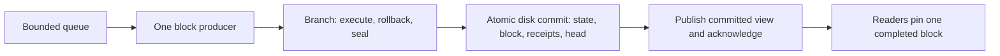

# Append-only node and durable block storage

## Direction and status

Scope requested on 2026-09-23: turn the embedded engine into a running
pseudo node that appends blocks, then make its state and history durable.
This document specifies the additional work. Step N0a, an engine fix to
the physical traces of rejected queries, is done. Step N0b-1, counting-rule
version 3 (write charges that prepay root maintenance) and the version-2
record-key encoding that fits the SDK's 32-byte keys, is done. Step N0b-2,
the canonical binary codec with golden vectors (see the
[block format](block-format.md)), the engine's host-state map and the
fallible `try_` engine API, is done. Step N0b-3, block format version 1
with the block executor, static validation, selection, request identity
and replay (the `arkiv-node` library; see
[part 2 of the block format](block-format.md#part-2-block-format-version-1)),
is done. The volatile N1 producer/queue/RPC and full/light processes now
run under the [bounded demo contract](full-light-demo.md).
Step N2, the
versioned storage contract and the redb adapter experiment, is done: see the
[redb experiment](redb-experiment.md) for its gates and measurements. N2
does not persist the engine (N3) or add a node (N1, N4). Step N3a, the data
structure for persistent state (the `arkiv-db-trie` crate: a Merkle Patricia
map with lazily loaded stored nodes, staging, point proofs and a strict
verifier; see [the state trie notes](state-trie.md)), is implemented as a
standalone crate. Step N3b, the engine on that map, is done in memory: every
engine map is a `MerkleMap` with frozen state-format-1 encodings, every
state has a logical state root, the `try_` surface is fallible with branch
poisoning, and the physical literals were re-derived for the trie; its
persistence is now implemented by N3c engine storage v1; broader point
proofs (N3d) remain open. Protocol-2
headers and the complete equality-proof slice are implemented by the
2026-09-24 [full/light-node demo](full-light-demo.md): a continuous volatile producer, independently executing
full followers, authenticated light followers and complete proofs for one
bounded equality-query profile. That proof slice precedes durability. The storage work below and broader query proofs/SDK integration
remain subsequent deliverables; no pruning is part of the demo.
The completed [engine storage v1](engine-storage-v1.md) delivers
N3c integration of the actual engine with lazy durable snapshots, bounded
caching/preparation, incremental trie-object commits and a durable head.
It retains all history on disk and leaves transaction-body persistence,
node runtime/signing restart integration, and pruning/compaction outside
this engine milestone. Its [measured report](engine-storage-v1-report.md)
covers real engine crash/recovery, bounded startup, incremental writes,
proof parity and committed-tree release. A bounded N4 slice is now implemented
by the [unsigned simulator](simulator-node.md) and its
[atomic host composition profile](simulator-storage-profile.md): one-file
state/body/inclusion/feed publication, same-run restart without replay, full replay
followers and a persisted light-header catalog. Its independent PostgreSQL explorer
lives on the explicitly authorized indexer `experimental` branch. General external
transaction admission, durable signing integration and broader N4 policy remain
later work; the existing signed volatile demo stays separate.
The [one-block query contract](single-block-query-proofs.md) and
[namespace isolation contract](project-namespaces.md) still apply.

The first node has one producer, one canonical chain, and one writer. It
executes many ordered operations per block and never replaces an appended
block. It has a real process, bounded submission queue, local RPC, block
lookup, historical queries, a data directory, and restart behavior. Peer
networking, distributed consensus, forks and reorgs are outside this first
node. A locally committed block is final under this development host's
rules; its header alone is not evidence of public-chain consensus.

Use redb directly behind a narrow storage adapter as the first candidate.
Clone it for study; do not begin by copying its allocator or maintaining a
fork. Keep the memory engine as a reference backend. RAM caches remain
disposable and bounded; disk becomes authoritative for committed state.

## What the code already supplies, and what must change

| Existing component | Additional work |
| --- | --- |
| `Engine`, `Branch`, checkpoints, `seal`, `publish` | A serialized producer and a durable publication path; the current `publish` only appends to an in-process vector |
| `host::BlockMap` | A persisted chain catalog containing stable block identities; the helper's per-instance `SnapshotId` is not a disk identity |
| `PersistentMap` with `Arc` links (replaced by `arkiv-db-trie::MerkleMap` in N3b) | Immutable nodes with persistent references and fallible lazy loading (the trie has both since N3a/N3b; the durable loader is N3c); serializing every complete map at each block is insufficient |
| Namespace-local rows, keys, postings and raw maps | Persist all their historical roots and reachable data together, including descriptors and ID allocators |
| `KvStore::write_batch` | A separate versioned commit contract; `KvStore` neither describes historical roots nor permits an uncertain commit result |
| `expire_records` | Host sequencing, reserved system budget and an all-or-none block rule if the sweep halts |
| Metering and isolation tests | Lost physical counters on early query errors: fixed in step N0a; extend measurement to storage and failure paths |

Implementing redb only underneath `Database<KvStore>` would leave the actual
engine volatile: these APIs currently share no state.

## Block and process contract

Freeze a versioned binary encoding with golden vectors before persisting
blocks. JSON is transport only; do not hash Rust debug output or arbitrary
JSON serialization. The block schema contains:

- A header: protocol version, chain identity, height, parent hash,
  producer-chosen timestamp, ordered transaction digest, execution-outcome
  digest, and the terminal logical state root once roots exist.
- Ordered transaction envelopes: client request identity, authenticated actor
  context, operations, operation/transaction budgets, and transaction order.
- Outcomes: success/failure, execution receipts, rollback spans, operations
  not executed after a failure, and aggregate charged units. Admission
  failures that never execute remain distinguishable from execution failures.
- Storage metadata, outside the logical header hash: manifest identity,
  physical root references, format versions and durable inclusion lookup.

Height zero is a durable genesis containing limits, initial pricing, protocol
versions and initial state. Every successor is exactly `head + 1` and names
the current parent hash; height exhaustion is an error, never a wraparound.
An empty user block still has a header and terminal
state; expiry can make it a nonempty state transition. Physical node IDs,
cache state, file positions and process tokens never enter logical hashes.
The block hash may include the state root; that root must not include the
block's own hash.

Node execution uses one branch and one terminal publication per block:

1. Capture the parent and deterministic block inputs. Timer time chooses the
   timestamp only when producing; replay reads the recorded timestamp.
2. Apply scheduled host/admin inputs in their specified order, then expire
   records due at this height, then execute selected user transactions in
   queue order. A pricing change affects the next block; execution stays on
   the parent-pinned schedule as it does today.
3. Take a checkpoint per user transaction. On its first execution failure,
   roll back that transaction's state, retain its charged work/receipts,
   mark its remaining operations unexecuted, and continue with the next
   eligible transaction. Budget reservation and queue selection must be
   deterministic for a recorded block packet.
4. Finish index/root maintenance, seal, commit, and expose exactly one
   terminal block view. No external query can access the branch.

Reserve system and finalization capacity before admitting user work. In the
node, an incomplete expiry sweep aborts the candidate: do not publish a
block that advertises exclusive expiry while retaining due records. The
current helper intentionally leaves partial work in its branch, so the host
must discard or roll that work back on a halt. Initially bound expiry
admission per height so due work fits, accounting for later patches and
expiry extensions as well as creation; maintain a host due-work schedule
transactionally rather than discovering it by scanning every namespace.
User submissions cannot write host-owned expiry cells or invoke the host
authorization bypass. Expiry discovery has its own bounded system-work
budget even though its read receipts are not user gas receipts.

The first transport trusts explicitly configured local development actors;
it must label that mode and bind locally by default. Real signature checking
can be added at the host boundary later. Persist the accepted actor context
and input so replay does not depend on a new authentication decision.

The runtime needs manual `produceBlock` for deterministic tests and an
optional interval producer, one bounded queue, transaction status and block
lookup, and graceful shutdown. All production triggers use the same writer
path. A queue acceptance response means **pending in memory**, not durable
inclusion. Only a committed-block response promises survival of restart.
Pending requests can be resubmitted; persisted inclusion identities prevent
executing an already included request twice. Scope request identities by
chain and actor. Reusing an identity with different contents is an explicit
conflict. This is inclusion deduplication, not a promise that pending queue
contents survive restart.

Reads accept one block number, or resolve `latest` once and return the
resolved number/hash. Pagination remains on that block as new blocks arrive.
Unknown, future, unavailable and unsupported-proof requests have distinct
errors; none become an empty result or a head substitution. Transport
decoding, queue length/bytes, block bytes, operation count, read work and
response bytes all have explicit limits. The existing 20-character names,
20-byte local raw keys and 64-byte indexed values remain admission bounds;
field/payload limits stay separate.

## redb assessment and implementation gate

Reviewed upstream source at
[`32920ec`](https://github.com/cberner/redb/tree/32920ec63fcc97215f83a76617360a006f6784ab)
and release
[`v4.3.0`](https://github.com/cberner/redb/tree/2de02fa48d1b8e265f388ea90151bf86f452e562).
The review added no copied source. Step N2 adds redb 4.3.0 as a pinned
dependency of `arkiv-db-redb` only (`=4.3.0`, `default-features = false`,
`features = ["std"]`); the reviewed dependency graph is recorded in the
[redb experiment](redb-experiment.md#dependency-review).

| Approach | Decision |
| --- | --- |
| redb library, Arkiv versioning above it | First implementation candidate: concentrate our work on block semantics, namespace isolation and history |
| Vendor/fork redb | Only for an identified change unavailable through its public API; pin provenance/licenses and account for upstream maintenance |
| Build a redb-inspired pager | Later alternative if measurements show a concrete limitation; requires our own allocation, commit, recovery and corruption tests |

redb supplies copy-on-write B+trees, one writer with concurrent readers and
atomic transactions across tables. Its page checksums are storage integrity
checks, not Arkiv cryptographic proofs. See the upstream
[design](https://github.com/cberner/redb/blob/2de02fa48d1b8e265f388ea90151bf86f452e562/docs/design.md).
Use one redb transaction for an entire block and request
[`Durability::Immediate`](https://docs.rs/redb/4.3.0/redb/enum.Durability.html)
before acknowledging it.

Persistent savepoints support rollback and retain old pages; they are not an
API for opening arbitrary historical blocks concurrently. Do not create one
savepoint per block or restore a savepoint to answer a historical query. Arkiv
must retain its own immutable versions, accessible from the current storage
transaction. See
[the savepoint API](https://docs.rs/redb/4.3.0/redb/struct.WriteTransaction.html#method.persistent_savepoint).

Default redb crash recovery can walk the whole database. Evaluate
`set_quick_repair(true)` on every durable transaction, including genesis
and maintenance. It stores allocator state and enables two-phase commit;
measure the commit cost and recovery I/O rather than asserting constant-time
restart. Audit compaction separately because it has a different path. See
[the recovery options](https://github.com/cberner/redb/blob/2de02fa48d1b8e265f388ea90151bf86f452e562/src/transactions.rs#L1581-L1605).

The inspected release requires Rust 1.90; the workspace declared 1.88.
Step N2 raised the workspace `rust-version` to 1.90 and checks the workspace
with `cargo +1.90.0 check --workspace --all-targets`. Its Linux build uses
`libc`, so the disk adapter is not standard-library-only; the contracts and
the memory stores still are. See its
[manifest](https://github.com/cberner/redb/blob/2de02fa48d1b8e265f388ea90151bf86f452e562/Cargo.toml).

## Disk state and retained history

Introduce a narrow versioned-state storage interface in `arkiv-db-storage`,
with memory and redb implementations. Put actual redb code in a new
`arkiv-db-redb` crate and the running host in `arkiv-node`; keep record,
query and proof semantics in `arkiv-db`. Add crates only with working code.

The storage contract needs fallible reads of immutable objects, a staged
write set, atomic commit against an expected durable head, a lookup to
reconcile a commit identity, and opening a retained manifest. Engine reads
must propagate storage/corruption errors, including errors during iteration;
an unreadable node cannot mean a missing record. A commit has three possible
outcomes: committed, definitely not committed, or indeterminate. This cannot
be hidden behind the raw KV contract's error-means-unchanged rule.
An I/O failure during execution aborts production and is reported as a local
availability error; it must not become a deterministic user rejection in a
committed block's outcomes.

Initial logical layout, all inside one transactional database file:

The append-only guarantee applies to canonical blocks and retained states;
the storage backend may update physical metadata and reclaim pages no
retained state references.

| Stored object | Contents |
| --- | --- |
| Database metadata | Database/chain identity, genesis hash, codec/protocol versions, configured limits and current durable head |
| Blocks and outcomes | Immutable headers, ordered inputs, outcomes/receipts and inclusion identities keyed by height/request identity |
| Block manifests | Terminal catalog root, global allocator/pricing state and authenticated root; no full copy of every namespace per block |
| Versioned namespace catalog | Descriptor `{id, name, owner, revision}` and roots of that namespace's raw map, key bindings, rows and terms |
| Namespace object storage | Immutable tree nodes, row/cell values and posting nodes; old versions remain reachable from old manifests |
| Proof storage | Historical authenticated nodes and values needed by the supported proof format |
| Host state | Scheduled admin/expiry work and any other state required to deterministically execute the next block |

Host state affecting execution must be committed in the versioned logical
state or deterministically derived from committed inputs/state. Keep derived
expiry scheduling consistent in the same transaction; replay must not depend
on a private scheduler that differs between nodes.

Adapt structural sharing to disk references: a modified path creates new
nodes, while unchanged subtrees keep their existing references. Stage only
objects reachable from the final candidate, deduplicate repeated changes
within the block, and discard unreachable nodes from rolled-back work.
Preserve namespace and record allocator state; rebuild neither IDs nor
indexes by guessing from current records after restart. Owner transfer
updates metadata without copying the namespace's records, indexes or history.

Start the adapter experiment with one namespace object table per namespace,
plus bounded shared metadata/directory access. A single global table with
namespace prefixes is not sufficient evidence of isolation. Persistent
directory nodes, redb table lookup and allocator work also need measured,
documented bounds: a global historical object lookup whose path grows with
other projects cannot be hidden behind the current constant directory fee.
The storage gate must either establish the contract for the selected layout
or change that layout before claiming durable isolation. Report logical
visits, backend page reads/writes and shared maintenance separately; shared
disk latency is not a constant-latency guarantee.

Use a bounded RAM cache keyed by database identity and immutable object
identity (including namespace where IDs are local). The cache is never the
only owner of historical data. Opening a block reads a manifest and loads
its data lazily; opening the database must not deserialize all namespaces,
rebuild all indexes or replay all prior blocks. A journal-plus-replay demo is
not completion of this storage milestone. Blocks remain available for audit
and offline replay to check independently produced outcomes and roots.

Physical tree shape and redb page IDs are not canonical state. Integrate
logical authenticated roots separately using the existing milestone-3 trie
plan. Until that milestone lands, the memory node advertises proofs as
unsupported and does not call a storage checksum a state root. The first
durable-node acceptance release includes authenticated roots and point
proofs; the narrow equality demo precedes it, while broader complete query
proofs follow. This avoids a permanent chain of
headers with no authenticated historical state. Development formats may
require an explicit new genesis/data directory; do not silently rewrite old
headers or fabricate roots for them.

Keep all blocks and their reachable objects initially. Disable application
pruning and online compaction in the first durable release; expose disk
usage and a storage-full error. This is an explicit unbounded-history disk
policy, not unbounded RAM retention. Later GC/compaction must protect every
retained manifest and active read handle, including historical postings and
proof witnesses. Root hashes alone do not preserve answer availability.

## Atomic durable publication and restart

Under the single-writer lock, validate the expected parent, prepare the
candidate and all encoding/allocation work needed to publish it, and start
the storage transaction. Atomically write new objects, host state, manifest,
block inputs/outcomes, inclusion records and head. Commit durably, then swap
the public committed view and acknowledge. Never expose an in-memory block
and subsequently try to make it durable. The existing independent
`Engine::publish`/`BlockMap::record` pair cannot implement this contract.

If a write or sync fails, do not assume noncommit. Stop further production
and reconcile the candidate identity from durable storage, reopening if
necessary. If it exists at the expected height/parent with identical content,
finish publication and return the recorded outcome; if it is absent after
successful recovery, retry the same candidate; if storage cannot establish
either, report an indeterminate/unavailable outcome and keep writes stopped.
After disk commit but before RAM publication, failure requires reloading the
committed head, not executing that block again. Previously pinned readers
can retain their old complete state.

On restart, validate chain/genesis and format versions, recover the storage
transaction, and load the durable head/manifest. Historical blocks open on
demand. Acknowledged blocks must survive; an unacknowledged candidate may be
wholly present or absent, never partially visible. Process-local snapshot
IDs and cursors are not reused accidentally. Initially expire cursors across
restart explicitly; stable portable cursors are a separately versioned API
that binds chain, block hash, namespace, query and projection.

Two rules come from the N2 storage experiment
([redb experiment](redb-experiment.md)):

- **Creating files in the data directory.** A file whose existence a later
  start relies on must never be visible half-written under its final name,
  and its name must be durable. `RedbStore::create` does this for the store:
  it builds the store in `<file>.init` (redb's creation and the store's
  initialization commit, both synced), renames it into place and syncs the
  directory, so a crash during `init` leaves either no store or a complete
  one (`initialization.rs`). Any other file N4 writes into the data
  directory and reads at startup follows the same pattern (write a
  temporary name, sync it, rename, sync the directory).
- **Reading a commit back after a failed sync.** After a failed `fsync`,
  Linux can mark the pages it could not write clean, so they keep serving
  reads without being on the medium. A commit whose final sync failed and
  that `reconcile` reads back as committed has therefore not been proven
  durable by that read. In the N2 model this case is durable only because
  of redb's two-phase commit: the data pages were synced before the header,
  and the reopen in `recover()` rewrites and syncs the header; without
  quick repair the same sequence left a file redb refuses after a power cut
  (`reconciliation.rs`). N4 keeps quick repair on, acknowledges such a block
  only after the reconciliation (including its reopen) has returned, and
  reports every sync failure as a possible data-loss event; other kernels'
  `fsync` error semantics and page-cache eviction between the failure and
  the reopen are not modelled.

Bound and measure both application startup work and backend recovery work.
No full-chain replay or full data/index scan is acceptable for normal crash
recovery. Loading allocator metadata may still scale with storage size;
record that cost and compare it with the stronger upstream recovery target
instead of claiming the target solely because quick repair is enabled.

## Ordered implementation steps and exit criteria

The step names below remain feature groups, not a strict schedule. The
[demo steps D0–D3](full-light-demo.md#implementation-order-and-review-gates)
have supplied N1, protocol-2/follower transport and the narrow in-memory
complete-Eq proof slice. [Engine storage v1](engine-storage-v1.md) now supplies
N3c and the bounded unsigned-simulator N4 slice; next address broader N4 policy
and the remaining N3d/N5 work. Engine-only durable
publication does not complete durable node integration. N6
retention/pruning stays later.

| Step | Deliverable | Evidence required before proceeding |
| --- | --- | --- |
| N0. Correctness and formats (done) | N0a (done): fix early-error physical traces. N0b-1 (done): cost model 3 and `RecordKey` encoding v2. N0b-2 (done): canonical codec version 1, engine host-state map, fallible `try_` API. N0b-3 (done): block/genesis/outcome formats, transaction failure semantics, expiry capacity and host input ordering, as the `arkiv-node` library | N0a met: failed queries and counts retain visited-node counters without double counting (`trace_regression.rs`). N0b-1 met: every hand-derived receipt literal re-derived for model 3 and the key vectors for encoding v2 (see below). N0b-2 met: hand-built golden vectors for every engine type in the codec, host-state rollback/publication/isolation and `try_` parity tests (see below). N0b-3 met: golden block vectors, deterministic block replay fixtures and an independent block-model oracle (see below) |
| N1. Running memory node | Executable with manual/interval production, bounded queue, local RPC, transaction status, block lookup and queries pinned to one block | One process produces multi-operation and empty blocks; concurrent reads see only completed states; failed transactions and same-block owner transfer behave correctly; latest pagination stays pinned |
| N2. redb adapter experiment (done) | Pin dependency/toolchain, exercise cross-table block commits, versioned object lookup, quick repair and failure injection | Reopen old and new versions concurrently; lost-ack reconciliation; recovery I/O and namespace-isolation measurements; record whether redb passes each gate. Met: gates and numbers in [redb-experiment.md](redb-experiment.md) |
| N3. Persistent engine and roots | N3a/N3b done: trie maps, roots and fallible internals. N3c done: [engine storage v1](engine-storage-v1.md), lazy immutable engine storage with bounded cache/preparation, manifests, durable head and historical Eq proofs. N3d: remaining point proofs | Root/receipt vectors unchanged; shared seeded histories pass on memory and real redb. Crash/process cuts, conservative uncertainty, incremental writes, cold-start and committed-tree release gates pass; see [engine measurements](engine-storage-v1-report.md). No durable node claim. |
| N4. Durable node integration (bounded unsigned simulator implemented) | Wire the producer to atomic block/state/head publication; startup, exclusive writer lock, shutdown and inclusion retry support | Kill/reopen at each publication boundary; every acknowledged block survives and every exposed block is complete; restart continues at the next height; queries at old heights work with a small cache |
| N5. Complete proofs and SDK | Existing milestone 4, now through the running durable node | Independent verifier detects omitted matches and wrong block/namespace/page coverage; SDK historical queries survive later blocks and restarts; unsupported proofs fail explicitly |
| N6. Capacity and archive operation | Workload calibration, long-run history policy, safe compaction/GC, snapshot export/import and backfill | Commit-fit limits and measured scaling; retention/import never advertise missing historical values, indexes or proof data |

N0a is done. The query evaluator now owns each group from the moment its
source is open. One helper notes every opened source's traversal once, after
the read stops, whether it completed or was rejected. A `Range`/`StartsWith`
run stopped at a `TermVisit` notes the postings it had positioned, because
no group will own them. Before the fix, a rejection while opening a later
group or pulling a first head dropped the traversals of the sources already
open, and a stopped run dropped its positioned postings. Rejections during
advances and row emission were already reported in full. Charges, their
order and receipts are unchanged. Evidence:
[`trace_regression.rs`](../crates/arkiv-db/tests/trace_regression.rs) has
exact hand-derived traces at every charge point, and all seven of its tests
fail against the previous evaluator.

N0b-1 is done. `MODEL_VERSION` is 3: `OperationClass` gains `RootUpdate`,
`RowByte`, `ProofNode` and `ProofByte` (31 classes; fixture weights 2, 1, 2
and 1). Every write adds `RootUpdate` per logical map-entry write to the
atomic group it already charged (a namespace creation or transfer 1, a raw
put or delete 2, a record creation or deletion 3, a patch 2, every index
insert or removal 2), and typed record writes add `RowByte` for the stored
row they leave behind. `ProofNode`/`ProofByte` now serve the separately
versioned [model-4 Eq proof read rules](eq-proof-charges.md). Model-3 write
charges, their check order and existing read rules are unchanged. The rationale and the worst-case rehash bounds are in
the [charge table](snapshot-query-plan.md#operation-cost-is-part-of-the-first-milestone)
(node step N3b replaced that table's path bounds with the creation bounds
`2L + 2` and measured rehashing against them).
`RecordKey` accepts 1 to 32 bytes; its canonical encoding version 2 is 33
bytes, and the 32-byte version-1 form remains only for explicit migration
(see [the record-key encoding](snapshot-query-plan.md#record-model-and-query-subset)).
Evidence: the meter and record unit tests, the rewritten key vectors in
`records.rs`, and every receipt literal and transcribed charge table in the
engine tests and `examples/records.rs`, re-derived by hand; the memory
engine computed no roots then; N3b added them under the same receipts.

N0b-2 is done. `arkiv_db::codec` is the canonical binary codec, version 1:
big-endian fixed-width integers, `00`/`01` booleans and options,
`u32`-length-prefixed bytes and text, `u32`-counted sequences whose
decoders never reserve beyond the remaining input, one explicit tag byte per
enum variant (never reused), exact consumption, and strict decoders that
enforce every type invariant (names, key length, nonzero ids, type ids,
UTF-8, 31 price classes) but leave admission limits to the engine. It
covers the engine types blocks and state will carry (ids, names, values,
cells, record keys, `WriteOp`, `Effect`, `Rejection` with its faults,
`Outcome`, `Receipt` without its ledger, `PriceSchedule`, `Limits`,
`NamespaceDescriptor`), and `digest(domain, bytes) = keccak256(u8
len(domain) ‖ domain ‖ bytes)` is the only hash of encoded bytes. The
[block format](block-format.md) specifies the layouts, tag tables and
compatibility rules. Every engine state now also holds a host-owned map
(32-byte keys, values of at most 256 bytes) that checkpoints roll back,
publication carries and snapshots retain, reachable only through unmetered
`try_host_*` calls, never through the data plane; and every state-walking
`Branch`/`Snapshot` method has a `try_` form returning
`Result<_, StorageError>` (the storage contract's error), plus
`host::try_expire_records`. On the in-memory engine the `try_` forms never
fail; N3b made them fallible (below). Evidence: `codec.rs` (hand-built golden
vectors, non-canonical rejections, exhaustive short inputs and mutations,
digests over hand-built preimages), `host_state.rs` and `fallible_api.rs`
(see the [test strategy](testing.md)).

N0b-3 is done. The `arkiv-node` library defines block format version 1
(genesis, headers v1 without a state root and the v2 layout with one,
block inputs with admin inputs and transaction envelopes, outcomes with
admin outcomes, expiry deletions and per-operation outcomes and receipts)
with domain-separated hashes, and `execute_block`, the one function that
produces and replays a block on one branch: admin inputs (`SetPricing`
takes effect in the next block and must keep the expiry reservation), the
expiry sweep over a due schedule kept in the engine's host-state map, then
user transactions under per-transaction checkpoints (the first failure
rolls the transaction back with its receipts kept and its later operations
not executed). User expiries are resolved by the host (`E = max(expires_at,
height + min_lifetime)`, permanent, extend-only, per-height capacity) and
injected as `$expiresAt`; users cannot write `$` cells. The genesis
invariants reserve block budget for the largest possible expiry work, so
user operations never meet `ExceedsBlockBudget`, and a storage error,
schedule inconsistency, expiry halt or broken invariant discards the
candidate instead of producing a block. Static validation (applied to each
operation as it will execute), FIFO selection, request identities (scope,
chain, actor, request id; pending versus included; conflicts) and
`MemoryChain`/`replay` complete it. Evidence (`cargo test -p arkiv-node
--offline`): `block_format.rs` (hand-built golden vectors and digests,
strict decoding), `replay.rs` (14 fixtures with hand-derived outcomes and
golden block hashes, replayed to identical bytes), `block_model.rs` (4
seeds × 60 blocks, every outcome predicted by an independent oracle with
its own charge table, record model and due schedule, and state compared at
every height and after replay), and `exec.rs`, `genesis.rs`,
`validation.rs`, `selection.rs`, `identity.rs`. Not established: the
storage-error path, which the memory engine cannot exercise (N3b/N3c).

N2 is done. The contract is `arkiv_db_storage::versioned` (objects put if
absent per space, insert-only records, a head compare-and-set, the outcomes
`Committed`, `NotCommitted` and `Indeterminate`, latching health and
`recover()`), with `MemoryVersionedStore`, `FaultyStore` and one behavioural
suite for every store. `RedbStore` (`arkiv-db-redb`) keeps one redb table
per namespace and commits each batch in one immediate-durability,
quick-repair transaction. Its gates, from the
[redb experiment](redb-experiment.md): atomicity at every crash point of a
block commit, torn writes included, after a restart and in steady state
(28,476 crash images in the release run, all parent or candidate and all
accepted by redb's integrity check); immediate durability; historical
objects after reopen and during commits without savepoints; reconciliation
of indeterminate commits, including ones that did commit; latching until
`recover()`; disk full —
always a `Full` outcome, never applied twice, the identical batch committed
once space returned — all passed under the documented power-loss and quota
models. Creating a store is crash-safe on a path (it is built in a temporary
file and renamed into place), not in place on a raw backend. Isolation passed
with a narrowed physical claim: a namespace's reads are unchanged by other
namespaces' growth and by history, but each read also descends redb's table
directory, whose height grows logarithmically with the number of namespaces.
Recovery passed its criterion (constant application reads at open) while
backend bytes at open and per commit grow with the file (quick repair: 25 KB
read at open for 17 MB, 152 KB for 1.08 GB). A commit writes about 65 KB and
syncs twice even when empty, which dominates small blocks. redb 4.3.0 is the
engine for N3 and N4.

N3a is done: the `arkiv-db-trie` crate (see the
[state trie notes](state-trie.md)). N3b is done in memory. Every engine map
(catalog, host map, and per namespace the raw records, key bindings, rows,
terms and the postings nested in term leaves) is a `MerkleMap` keyed by the
frozen state-format-1 encodings (8-byte ids, 32-byte host keys, 21-byte
padded raw keys, 33-byte `RecordKey`, the 164-byte term composite) with
canonical-codec leaves; the catalog leaf carries each namespace's
descriptor, record allocator and map roots. `state_root =
digest("arkiv/state/v1", encode(StateHeader { format 1, catalog root and
length, next_namespace, pricing, host root and length }))` is exposed on
snapshots and sealed candidates, computed lazily from cached node hashes.
Every map operation takes a loader: the trie crate's memory-only loader, or
an `ObjectReader` behind the hidden `Engine::from_state` test aid, which is
where N3c adds its gated store context and encoded cache through the
separate durable facade. Storage errors surface from
every `try_` form, never as rejections or receipts, and poison a branch
(`EngineError::Poisoned`). Receipts are unchanged; physical traces follow
trie visits (17 directory nodes per lookup at most, 34 per write), and every
structure-specific literal was re-derived by hand. Evidence: `roots.rs`,
`storage_faults.rs`, `rehash.rs`, `trace_regression.rs`, `isolation.rs`
and `query_isolation.rs` (see the [test strategy](testing.md)). Not done in
N3b: persistence (N3c) and broader point proofs (N3d). Protocol 2 / header
v2 and the bounded Eq-page proof slice now ship in the demo.

N1 is the first useful runnable deliverable, explicitly volatile. N2 was a
bounded implementation experiment, not a claim of durable engine support.
N3 includes the old point-proof milestone; N4 delivers durable block
production before the remainder of N5's complete proofs and SDK work. The
demo explicitly pulls the small equality-proof slice forward. Do not mark
persistence finished with a durable log while query state still requires
replay into RAM.

The codec migration rules and the digest-domain convention are settled
(N0b-2, see the [block format](block-format.md)): tags are never reused, a
layout change needs a new codec version and an explicit migration, the
containers that store or hash codec bytes (the block format in N0b-3, the
store metadata in N4) record the codec version, and each hashed object has
its own `arkiv/<object>/v<n>` domain. The state and leaf layouts and the
state-root domain (`arkiv/state/v1`) are settled by N3b (state format 1);
engine manifest identities are frozen by N3c's engine-only profile. The SDK
32-byte record-key gap is settled
(N0b-1): the versioned key encoding v2 supports the SDK's full key width,
and version-1 encodings are never silently reinterpreted. The cost-model
change for root maintenance is counting-rule version 3 with re-derived
golden receipts (N0b-1). Canonical charges must remain independent of
cache warmth, redb page layout, actual fsync latency and recovery work;
measure physical I/O separately and reserve bounded finalization resources.

## Acceptance workloads

Add process/storage tests alongside their implementation, building on the
existing block-packet reference models:

- Mixed create/patch/delete, namespace transfer, multi-operation transaction
  rollback, pricing changes, exact/insufficient budgets and exclusive expiry;
  compare every block's records, indexes, outcomes and roots with the oracle.
- Kill the process before storage commit, during writes/file growth/sync,
  after durable commit but before RAM publication, and after publication but
  before acknowledgement. Retry identical request IDs and reject conflicts.
- Model torn/unsynced writes and I/O errors through an instrumented storage
  backend as well as process kills; `SIGKILL` alone is not a power-loss test.
  Cover disk full, failed recovery, wrong genesis, corrupt/missing objects,
  unsupported formats and a second process attempting to become writer.
- Reopen with a small cache and query an old block after many later patches,
  deletions, expirations and owner transfers. Page while new blocks append;
  verify old roots/proofs and explicit cursor behavior across restart.
- Grow only namespace B while A is fixed, then grow namespace count and
  retained history separately. Measure A's logical work, tree visits, cold
  and warm page I/O, cache usage and proof bytes; identify shared costs.
- Compare few large blocks with many small blocks at equal operation volume.
  Record throughput, block latency, logical/physical bytes written, sync
  count, disk growth, peak RAM and restart reads/time. Include mostly empty
  blocks and expiry-heavy blocks. Establish capacity from these measurements;
  this plan does not assert a TPS or restart-time target without evidence.

If redb fails the recovery, isolation or write-amplification gate, retain
these contracts/tests and evaluate a different adapter or a focused fork.
A custom pager then needs its own copy-on-write pages, atomic root selection,
allocator recovery and retained-root reclamation; copying source alone does
not establish those guarantees.
